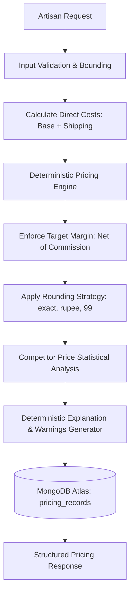

# Dynamic Pricing Agent — Architecture, Formulas & API Documentation

## 1. Overview & Architecture

The **Dynamic Pricing Agent** is an explainable, deterministic pricing engine designed specifically for traditional Indian artisans on the **KarigarConnect** platform. It enables artisans to calculate realistic selling prices that guarantee profitability after accounting for raw materials, artisan labor, workshop overhead, packaging, marketplace commissions, seller-paid shipping, and optional statutory taxes.

### Architectural Principles
- **Deterministic Arithmetic:** All financial calculations use Python's `Decimal` module with strict rounding controls (`ROUND_HALF_UP`) to prevent IEEE 754 binary floating-point errors.
- **Zero Hallucination / Independent of LLMs:** Pricing calculations do not rely on machine learning models or Gemini quotas. Arithmetic and explanations are 100% deterministic and available even when external AI APIs are offline.
- **Non-Invasive Market Context:** Competitor prices are accepted only as explicitly supplied, caller-provided observations. They are used exclusively as market context and never override the minimum profitable price.
- **Full Backward Compatibility:** The engine preserves existing API routes (`POST /api/pricing/calculate`, `GET /api/pricing/{product_id}`) while supporting rich breakdowns, scenario simulations, and paginated history.



---

## 2. Mathematical Formulas & Assumptions

### A. Cost Structure
Direct production costs and seller fulfillment expenses are aggregated into two primary levels:

1. **Base Production Cost ($B$):**
   $$B = \text{material\_cost} + \text{labor\_cost} + \text{packaging\_cost} + \text{overhead\_cost} + \text{other\_variable\_costs}$$

2. **Total Seller Cost ($C$):**
   $$C = B + \text{shipping\_cost}$$
   *Note:* `shipping_cost` represents seller-paid fulfillment expenses. Buyer-paid shipping is excluded to prevent double counting.

### B. Margin vs. Markup
It is essential to distinguish between **profit margin** and **cost markup**:
- **Markup:** Profit expressed as a percentage of cost:
  $$\text{Markup} = \frac{\text{Profit}}{\text{Cost}} \times 100$$
- **Profit Margin ($m$):** Profit expressed as a percentage of the final transaction price ($P_{\text{trans}}$):
  $$\text{Margin} = \frac{\text{Profit}}{P_{\text{trans}}} \times 100$$

KarigarConnect strictly implements **profit margin on selling price** ($m = \text{target\_profit\_margin\_percent} / 100$).

### C. Marketplace Commission ($c$)
Marketplace commission ($c = \text{marketplace\_commission\_percent} / 100$) is charged on the realized transaction revenue ($P_{\text{trans}}$):
$$\text{Commission Amount} = c \times P_{\text{trans}}$$
$$\text{Net Artisan Revenue} = P_{\text{trans}} \times (1 - c)$$

### D. Promotional Discounts ($d$)
When an artisan offers a promotional discount ($d = \text{discount\_percent} / 100$ off the listing price $P_{\text{list}}$):
$$P_{\text{trans}} = P_{\text{list}} \times (1 - d)$$
$$P_{\text{list}} = \frac{P_{\text{trans}}}{1 - d}$$

### E. Comprehensive Selling Price Derivation
Net artisan profit after seller expenses and marketplace deductions is:
$$\text{Profit} = \text{Net Artisan Revenue} - C = P_{\text{trans}} \times (1 - c) - C$$

To achieve the desired target profit margin $m$ where $\text{Profit} = m \times P_{\text{trans}}$:
$$P_{\text{trans}} \times (1 - c) - C = m \times P_{\text{trans}}$$
$$P_{\text{trans}} \times (1 - c - m) = C$$
$$P_{\text{trans}} = \frac{C}{1 - c - m}$$

And the customer-facing listing price is:
$$P_{\text{list}} = \frac{C}{(1 - c - m)(1 - d)}$$

#### Feasibility Constraint:
If $c + m \ge 1$, total percentage deductions equal or exceed 100% of revenue, leaving zero or negative contribution to cover production costs. Any request violating $c + m < 1$ is rejected with HTTP 422.

When $c = 0$ and $d = 0$, the formula simplifies to:
$$P_{\text{list}} = \frac{C}{1 - m}$$
which matches the original codebase baseline ($₹600 / 0.75 = ₹800$).

---

## 3. Rounding Strategies & Profitability Safeguards

KarigarConnect supports three rounding strategies (`pricing_strategy`):
1. **`exact` (default):** Mathematically exact price rounded to 2 decimal places using standard financial half-up rounding.
2. **`round_nearest_rupee`:** Rounded to the whole integer rupee. If rounding down would decrease the margin below target, the price is automatically rounded up (`math.ceil`).
3. **`psychological_99`:** Aligns price to psychological price endings (e.g. ₹799, ₹899, ₹999).

> [!IMPORTANT]
> The engine **never** rounds downward below the minimum required price. The final response reports the `estimated_profit_margin_percent` achieved by the actual rounded price.

---

## 4. Statutory Taxes (GST) Assumptions & Limitations

- **Default State:** Tax modeling is disabled by default (`tax_rate_percent: null`).
- **Tax-Exclusive (`tax_inclusive: false`):** Tax is added on top of the selling price:
  $$\text{Tax Amount} = P_{\text{trans}} \times \left(\frac{t}{100}\right)$$
- **Tax-Inclusive (`tax_inclusive: true`):** The selling price includes tax:
  $$\text{Price Before Tax} = \frac{P_{\text{trans}}}{1 + (t / 100)}$$
  $$\text{Tax Amount} = P_{\text{trans}} - \text{Price Before Tax}$$
- **Statutory Limitation:** KarigarConnect is an advisory tool, not a registered tax compliance authority. Tax collections represent statutory pass-through liabilities to the government, not artisan earnings.

---

## 5. Competitor Data Validation & Analysis

Competitor price observations must be explicitly supplied in the request. The engine validates:
1. Every observation must have `price > 0` and `price <= 10,000,000`.
2. Currency must match the base currency (default: `INR`). Mixed currencies without verified exchange rates are rejected.
3. Statistics computed: `min_price`, `max_price`, and `median_price`.
4. Position Labels (5% tolerance band around median):
   - `Below observed competitor median` ($P_{\text{sell}} < 0.95 \times \text{median}$)
   - `Near observed competitor median` ($0.95 \times \text{median} \le P_{\text{sell}} \le 1.05 \times \text{median}$)
   - `Above observed competitor median` ($P_{\text{sell}} > 1.05 \times \text{median}$)
5. Warnings:
   - Alerted if recommended price exceeds highest observed competitor.
   - Alerted if observed competitor median is below direct production costs.

---

## 6. Endpoints & Swagger Specifications

Base URL: `http://127.0.0.1:8000`  
Interactive Documentation: `http://127.0.0.1:8000/docs`

| Method | Endpoint | Description |
| :--- | :--- | :--- |
| `POST` | `/api/pricing/calculate` | Calculates recommended selling price, breaks down costs/fees, and saves to MongoDB. |
| `POST` | `/api/pricing/scenarios` | Simulates multiple target margins (e.g. 15%, 25%, 35%) for the same cost structure. |
| `GET` | `/api/pricing/{product_id}` | Backward-compatible history retrieval for a product (newest first). |
| `GET` | `/api/pricing/{product_id}/latest` | Retrieves single most recent pricing recommendation (returns 404 if not found). |
| `GET` | `/api/pricing/{product_id}/history` | Retrieves paginated pricing history with `limit` (1-100) and `skip` query parameters. |

---

## 7. MongoDB Persistence

- **Collection:** `pricing_records` in database `karigarconnect`.
- **Index:** `idx_product_id_created_at` on `{"product_id": 1, "created_at": -1}` created safely during app lifespan startup.
- **Timestamps:** Timezone-aware UTC `datetime.now(timezone.utc)` saved in MongoDB, serialized to ISO 8601 strings in API responses.
- **Backward Compatibility:** Normalization logic in `_normalize_pricing_record` safely handles legacy documents missing newly introduced fields.

---

## 8. Request & Response Examples

### A. Calculate Price (Comprehensive Request)
`POST /api/pricing/calculate`

```json
{
  "product_id": "PROD004",
  "product_name": "Handmade Bamboo Basket",
  "material_cost": 300,
  "labor_cost": 200,
  "packaging_cost": 50,
  "overhead_cost": 50,
  "shipping_cost": 50,
  "target_profit_margin_percent": 25,
  "marketplace_commission_percent": 10,
  "discount_percent": 0,
  "pricing_strategy": "exact",
  "competitor_prices": [
    {
      "price": 950,
      "currency": "INR",
      "source": "Etsy Artisan Shop",
      "is_verified": true
    },
    {
      "price": 1050,
      "currency": "INR",
      "source": "Craftsvilla",
      "is_verified": true
    }
  ]
}
```

#### Response:
```json
{
  "product_id": "PROD004",
  "product_name": "Handmade Bamboo Basket",
  "material_cost": 300.0,
  "labor_cost": 200.0,
  "packaging_cost": 50.0,
  "overhead_cost": 50.0,
  "shipping_cost": 50.0,
  "other_variable_costs": 0.0,
  "total_cost": 650.0,
  "target_profit_margin_percent": 25.0,
  "suggested_selling_price": 1000.0,
  "discounted_price": null,
  "estimated_profit": 250.0,
  "estimated_profit_margin_percent": 25.0,
  "currency": "INR",
  "pricing_method": "cost_plus_target_margin",
  "pricing_strategy": "exact",
  "requires_market_validation": true,
  "cost_breakdown": {
    "material_cost": 300.0,
    "labor_cost": 200.0,
    "packaging_cost": 50.0,
    "overhead_cost": 50.0,
    "shipping_cost": 50.0,
    "other_variable_costs": 0.0,
    "base_production_cost": 600.0,
    "total_seller_cost": 650.0
  },
  "fee_breakdown": {
    "marketplace_commission_percent": 10.0,
    "marketplace_commission_amount": 100.0,
    "discount_percent": 0.0,
    "discount_amount": 0.0,
    "tax_rate_percent": null,
    "tax_amount": 0.0,
    "tax_inclusive": false,
    "tax_disclaimer": "Tax amounts are statutory pass-through estimates and not seller profit. KarigarConnect is not a tax-compliance authority."
  },
  "competitor_analysis": {
    "market_data_available": true,
    "observation_count": 2,
    "min_price": 950.0,
    "max_price": 1050.0,
    "median_price": 1000.0,
    "price_position": "near_competitor_median",
    "position_label": "Near observed competitor median",
    "notes": [
      "Evaluated 2 valid competitor observation(s) in INR.",
      "Competitor prices are contextual and do not guarantee market demand, quality equivalence, or sales velocity."
    ]
  },
  "explanation": "Product: Handmade Bamboo Basket (PROD004)\n1. Base Production Cost: INR 600.00 (Material: 300.00, Labor: 200.00, Packaging: 50.00, Overhead: 50.00, Other: 0.00).\n2. Direct Shipping & Fulfillment: INR 50.00.\n3. Total Direct Seller Cost: INR 650.00.\n4. Marketplace Commission: 10.0% (INR 100.00 on realized transaction).\n6. Target Margin: 25.0% | Actual Achieved Margin: 25.00%.\n7. Estimated Artisan Profit: INR 250.00 per unit.\n9. Market Position: Near observed competitor median (Median: INR 1000.00).",
  "warnings": [],
  "record_id": "6ae3d60c941a1990c2247316",
  "created_at": "2026-10-30T00:00:00+00:00"
}
```

### B. Simulate Scenarios
`POST /api/pricing/scenarios`

```json
{
  "product_id": "PROD004",
  "product_name": "Handmade Bamboo Basket",
  "material_cost": 300,
  "labor_cost": 200,
  "packaging_cost": 50,
  "overhead_cost": 50,
  "target_profit_margins": [15.0, 25.0, 35.0],
  "marketplace_commission_percent": 10.0
}
```

---

## 9. Testing & Execution Commands

### Run Full Test Suite
```powershell
.venv\Scripts\python -m pytest backend/tests -v
```

### Run Standalone Baseline Tests
```powershell
.venv\Scripts\python -m backend.app.test_pricing
.venv\Scripts\python -m backend.app.test_pricing_persistence
```

### Start Backend Server
```powershell
.venv\Scripts\python -m uvicorn backend.app.main:app --reload
```
