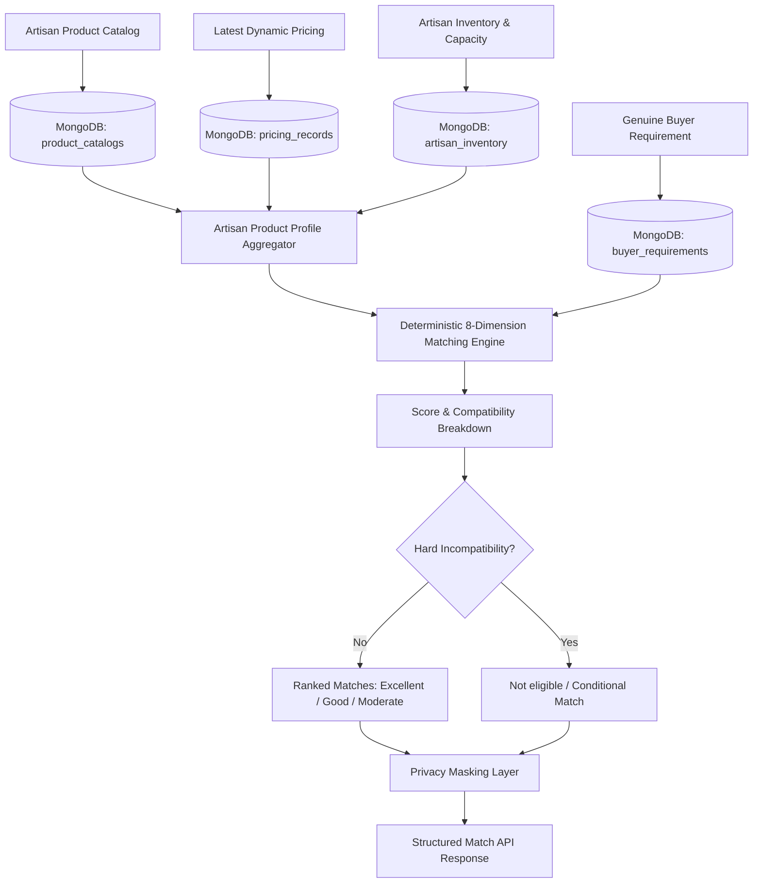

# Market Linkage Agent — Architecture, Matching Algorithm & API Documentation

## 1. Overview & Architecture

The **Market Linkage Agent** connects traditional Indian artisans and their handcrafted products with genuine wholesale, retail, institutional, and corporate buyer requirements stored in MongoDB Atlas.

### Key Architectural Principles
- **Genuine Database-Driven Matching:** Every match is evaluated against real, persisted buyer requirements in MongoDB (`buyer_requirements`). No fabricated buyer profiles, dummy companies, or artificial market opportunities are produced.
- **Deterministic & Explainable Evaluation:** Matching scores are computed via deterministic multi-dimensional algorithms using tokenized text overlap, category mapping, material compatibility, budget comparison, and capacity feasibility.
- **Independent of LLMs:** The core matching engine runs 100% deterministically in Python without depending on Google Gemini API availability or quotas.
- **Data Privacy by Design:** Buyer contact details (email and phone number) are masked by default across public listings and match summaries (`j***e@e***.com`, `***-***-3210`) and are revealed only to authorized users.
- **Zero Loss-Making Recommendations:** If a buyer's maximum budget is below the artisan's minimum viable selling price, the system marks the match as a budget incompatibility rather than recommending a loss-making transaction.



---

## 2. Multi-Dimensional Matching Algorithm

The matching engine evaluates 8 distinct business dimensions totaling 100 points:

| Dimension | Max Points | Weight | Description |
| :--- | :--- | :--- | :--- |
| **Category Alignment** | 20.0 | 20% | Exact category match (20 pts), category term in product description/purpose (15 pts), or related token match (10 pts). |
| **Keyword & Text Overlap** | 20.0 | 20% | Normalized tokenized overlap between product titles, descriptions, keywords and buyer requirement text. |
| **Material Compatibility** | 15.0 | 15% | Checks if artisan raw materials match buyer preferred materials. Unrestricted requirements receive full 15 pts. |
| **Craft-Type Compatibility** | 10.0 | 10% | Validates crafting technique (e.g. Handwoven, Block Print, Wood Carving, Brass Casting). |
| **Price & Budget Alignment** | 15.0 | 15% | Evaluates artisan selling price against buyer's unit budget. Full 15 pts for budget sweet spot; 13 pts if cheaper than minimum. |
| **Quantity Feasibility** | 10.0 | 10% | Ready inventory in stock (10 pts), or capacity fulfillment over delivery window (7 pts). Shortfall receives 0 pts. |
| **Delivery Turnaround** | 5.0 | 5% | Checks if production lead time $\le$ buyer delivery deadline (or already in stock). Infeasible lead times receive 0 pts. |
| **Location Compatibility** | 5.0 | 5% | Evaluates geographic serviceability and domestic logistics feasibility. |
| **Total** | **100.0** | **100%** | Comprehensive compatibility score. |

---

## 3. Feasibility Rules & Hard Incompatibilities

A match score is never allowed to hide a critical commercial barrier:
1. **Currency Incompatibility:** If the buyer requirement and artisan product use different currencies (e.g. USD vs INR), the budget score is set to 0.0, budget compatibility is `false`, and the match is marked **"Not eligible"**.
2. **Severe Budget Deficit:** If the artisan unit price exceeds the buyer's maximum budget by more than 10%, the budget compatibility flag is marked `false`, and the match cannot receive an "Excellent" or "Good" rating.
3. **Capacity Shortfall:** If the combined ready stock and monthly crafting capacity over the deadline cannot satisfy the buyer's requested quantity, the quantity score is 0.0, quantity compatibility is `false`, and an explicit shortfall warning is attached.
4. **Delivery Deadline Infeasibility:** If the artisan's production lead time exceeds the buyer's required delivery window and insufficient ready stock exists, delivery compatibility is marked `false`.

### Match Classification Hierarchy:
- **`Excellent`:** Score $\ge 80.0$, category aligned, budget compatible, and quantity fully feasible.
- **`Good`:** Score $\ge 65.0$, category aligned, and budget compatible.
- **`Moderate`:** Score $\ge 50.0$ and budget compatible.
- **`Conditional`:** Quantity or delivery requires scheduling/batch confirmation, or price is within a 10% negotiation margin.
- **`Not eligible`:** Hard commercial incompatibility (severe budget mismatch, currency mismatch, or low semantic similarity).

---

## 4. Artisan Data Integration

The Market Linkage Agent automatically aggregates three distinct repository collections without duplicating data:
1. **`product_catalogs`:** Retrieves artisan product name, product title, detailed description, search keywords, material, color, craft style, and intended purpose.
2. **`pricing_records`:** Retrieves the latest valid suggested selling price and currency calculated by the Dynamic Pricing Agent.
3. **`artisan_inventory`:** Retrieves operational parameters including ready inventory stock (`available_quantity`), monthly production capacity (`production_capacity_per_month`), minimum order quantity (`minimum_order_quantity`), lead time (`production_lead_time_days`), and workshop location.
   - *Default Fallback:* If an artisan has not yet populated inventory parameters, the engine applies sensible craft defaults (Available: 10, Capacity: 50/mo, Lead time: 14 days) and attaches an advisory warning.

---

## 5. Security & Data Privacy

1. **Contact Information Protection:** In all public requirement listings (`GET /api/buyers/requirements`) and match summaries (`GET /api/market-linkage/product/{product_id}/matches`), buyer contact details are automatically masked:
   - Email: `sourcing@fabindia.example.com` $\rightarrow$ `s***g@f***.com`
   - Phone: `+91-9876543210` $\rightarrow$ `***-***-3210`
2. **Authorized Access:** Unmasked contact details are accessible only when explicitly passing `authorized=true` to `GET /api/buyers/requirements/{requirement_id}` for confirmed artisans or platform administrators.
3. **No Unsafe Dynamic Queries:** MongoDB queries use sanitized equality and range dictionaries; raw client strings are never passed as query operators.
4. **Soft Deletion:** Deleting a buyer requirement transitions its status to `cancelled` by default (`hard_delete=false`) to preserve transaction traceability.

---

## 6. MongoDB Collections & Indexes

### A. `buyer_requirements`
- `requirement_id` (Unique index)
- `("requirement_status", 1), ("created_at", -1)` (Compound index for filtering active requirements)
- `("required_category", 1), ("requirement_status", 1)` (Compound index for category filtering)
- `buyer_id` (Index for buyer requirement lookup)

### B. `artisan_inventory`
- `product_id` (Unique index)
- `artisan_id` (Index for artisan inventory tracking)

### C. `market_linkage_matches`
- `match_id` (Unique index)
- `("product_id", 1), ("created_at", -1)` (Compound index)
- `("requirement_id", 1), ("created_at", -1)` (Compound index)

---

## 7. API Endpoints

Base URL: `http://127.0.0.1:8000`  
Swagger UI: `http://127.0.0.1:8000/docs`

| Method | Endpoint | Description |
| :--- | :--- | :--- |
| `POST` | `/api/buyers/requirements` | Register a new genuine buyer requirement. |
| `GET` | `/api/buyers/requirements` | List buyer requirements with pagination and category/status filters (contact masked). |
| `GET` | `/api/buyers/requirements/{requirement_id}` | Retrieve requirement by ID (masked by default; unmasked if `authorized=true`). |
| `PUT` | `/api/buyers/requirements/{requirement_id}` | Update requirement specifications. |
| `PATCH` | `/api/buyers/requirements/{requirement_id}/status` | Transition requirement status (`active`, `paused`, `fulfilled`, `cancelled`). |
| `DELETE`| `/api/buyers/requirements/{requirement_id}` | Archive/cancel requirement (or permanent delete if `hard_delete=true`). |
| `POST` | `/api/market-linkage/inventory` | Set or update artisan operational inventory and production capacity. |
| `GET` | `/api/market-linkage/inventory/{product_id}` | Retrieve current inventory and capacity settings for a product. |
| `GET` | `/api/market-linkage/product/{product_id}/matches` | Find matching buyer requirements for an artisan product. |
| `GET` | `/api/market-linkage/buyer/{requirement_id}/matches` | Find matching artisan catalog products for a buyer requirement. |

---

## 8. Example Requests & Responses

### A. Create Buyer Requirement
`POST /api/buyers/requirements`

```json
{
  "buyer_id": "BUYER_FABINDIA",
  "buyer_name": "FabIndia Lifestyle Ltd",
  "buyer_type": "Retailer",
  "required_category": "Storage",
  "requirement_title": "Eco-friendly Natural Bamboo Baskets",
  "description": "Looking for 100 sturdy handwoven bamboo storage baskets for seasonal gifting.",
  "required_keywords": ["bamboo", "storage", "basket", "handwoven"],
  "preferred_materials": ["bamboo", "cane"],
  "preferred_craft_types": ["handwoven"],
  "required_quantity": 100,
  "minimum_budget": 600.0,
  "maximum_budget": 950.0,
  "currency": "INR",
  "delivery_location": "Delhi, India",
  "delivery_deadline_days": 30,
  "contact_email": "procurement@fabindia.example.com",
  "contact_phone": "+91-9876543210",
  "requirement_status": "active"
}
```

### B. Find Matches for Artisan Product
`GET /api/market-linkage/product/PROD004/matches?min_score=40`

#### Response:
```json
{
  "product_id": "PROD004",
  "product_title": "Handwoven Natural Brown Bamboo Storage Basket",
  "total_matches": 1,
  "matches": [
    {
      "match_id": "MATCH-7F2A9B1C3D",
      "product_id": "PROD004",
      "requirement_id": "REQ-A1B2C3D4",
      "product_title": "Handwoven Natural Brown Bamboo Storage Basket",
      "buyer_name": "FabIndia Lifestyle Ltd",
      "buyer_type": "Retailer",
      "match_score": 87.0,
      "match_category": "Excellent",
      "compatibility": {
        "category": true,
        "material": true,
        "craft_type": true,
        "budget": true,
        "quantity": true,
        "delivery": true,
        "location": true
      },
      "score_breakdown": {
        "category_score": 20.0,
        "keyword_score": 15.0,
        "material_score": 15.0,
        "craft_type_score": 10.0,
        "price_score": 15.0,
        "quantity_score": 7.0,
        "location_score": 5.0,
        "delivery_score": 0.0,
        "total_score": 87.0
      },
      "warnings": [
        "Quantity condition: Ready stock is 40 units (buyer needs 100). Fulfillment requires crafting over 30 days at capacity 120/mo."
      ],
      "recommendation": "Strong mutual match across category, materials, budget, and quantity. Proceed with direct outreach and sample submission.",
      "buyer_summary": {
        "buyer_id": "BUYER_FABINDIA",
        "buyer_name": "FabIndia Lifestyle Ltd",
        "buyer_type": "Retailer",
        "delivery_location": "Delhi, India",
        "required_quantity": 100,
        "budget_range": "INR 600.00 - 950.00",
        "delivery_deadline_days": 30,
        "contact_email_masked": "p***t@f***.com",
        "contact_phone_masked": "***-***-3210"
      },
      "artisan_summary": {
        "product_id": "PROD004",
        "product_title": "Handwoven Natural Brown Bamboo Storage Basket",
        "unit_price": "INR 800.00",
        "material": "bamboo",
        "craft_type": "handwoven",
        "available_quantity": 40,
        "monthly_capacity": 120,
        "lead_time_days": 10
      },
      "created_at": "2026-10-30T13:19:00+00:00"
    }
  ]
}
```

---

## 9. Important Clarification: Matches vs. Orders

> [!IMPORTANT]
> A **Product Match** generated by the Market Linkage Agent indicates **commercial and technical compatibility** between an artisan product and an active buyer requirement. It does **not** constitute a legally binding purchase order, escrow payment, or guaranteed buyer purchase. Artisans must contact the buyer, submit physical samples, and agree upon formal contract terms.

---

## 10. Testing & Execution Commands

### Run Full Test Suite (All 62 Tests)
```powershell
.venv\Scripts\python -m pytest backend/tests -v
```

### Run Market Linkage Tests Only
```powershell
.venv\Scripts\python -m pytest backend/tests/test_market_linkage_unit.py backend/tests/test_market_linkage_api.py -v
```

### Start Backend Server
```powershell
.venv\Scripts\python -m uvicorn backend.app.main:app --reload
```
